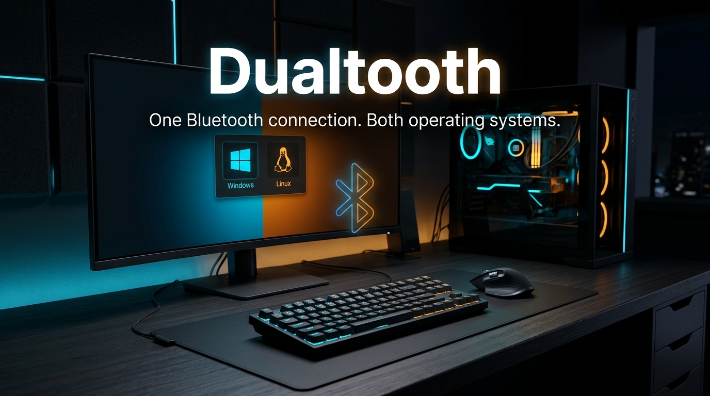
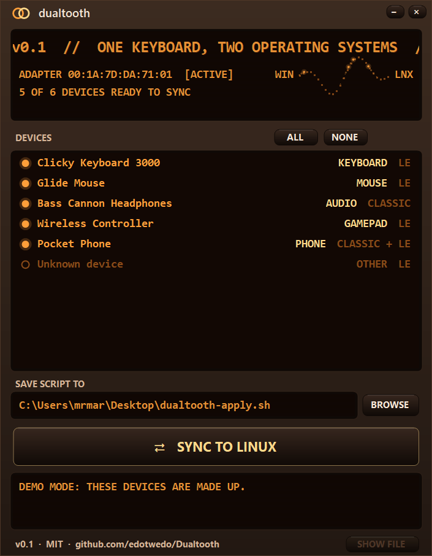

# Dualtooth

<p align="center">
  
</p>

<p align="center">
  <b>Use the same Bluetooth keyboard, mouse, headphones or controller in Windows and Linux without re-pairing every time you switch.</b>
</p>

<p align="center">
  <a href="https://buy.stripe.com/9B63cx3OWb9p6iPgFP9AA01"></a>
  <a href="https://github.com/edotwedo/Dualtooth/releases/latest"></a>
</p>

---

## Why pairing breaks

When you pair a device, it and the PC agree on a secret cryptographic key. Each device only remembers one key per PC, but Windows and Linux each generate their own when pairing. Whichever OS paired last works, and the other gets rejected. 

Dualtooth extracts Windows' keys safely and creates an automated script to install them directly into BlueZ on Linux so both systems share the exact same keys.

---

## Quick Start (Takes 60 Seconds)

1. **Make sure your devices work in Windows.** (Pair them in Windows first).
2. Download and run **[Dualtooth.exe](https://github.com/edotwedo/Dualtooth/releases/latest)** (standalone 64-bit executable, nothing to install).
3. Click your devices and press **CREATE LINUX SCRIPT**.
4. Reboot into Linux, open a terminal in that folder, and run:
   ```bash
   sudo bash dualtooth-apply.sh
   ```
5. Turn your Bluetooth mouse/keyboard off and on. Done!

<p align="center">
  
</p>

**Afterwards:** Delete the script, since it contains raw pairing keys. Do not pair these devices again in either OS, or you will need to re-run the sync.

---

## What the Linux script does

- Verifies that Linux detects the same physical Bluetooth adapter as Windows.
- Writes each device's key to `/var/lib/bluetooth/<adapter>/<device>/info` (backing up any existing file as `info.bak`).
- Sets `AutoEnable=true` in `/etc/bluetooth/main.conf` so Bluetooth keyboards work at the Linux login screen.
- Restarts the Linux Bluetooth service (`systemctl restart bluetooth`).

---

## Security & How it reads keys

Windows stores Bluetooth pairing keys in `HKLM\SYSTEM\CurrentControlSet\Services\BTHPORT\Parameters\Keys`, which only the SYSTEM account can read. 

Dualtooth activates the standard Windows backup privilege (`SeBackupPrivilege`, available to any local administrator) and opens those keys in **read-only** mode. It never writes to or alters your Windows registry.

---

## Support Independent Development

Dualtooth is built independently with no telemetry, no tracking, and no subscriptions. If it saved you an hour of registry hex editing, consider supporting ongoing development:

👉 **[Buy a Supporter License / Tip on Stripe](https://buy.stripe.com/9B63cx3OWb9p6iPgFP9AA01)**

---

## Mac users: help wanted 🍎

Dual-booting a Mac (Boot Camp, Asahi Linux or a Hackintosh)? We'd love to add macOS support, but need real Macs to test on. A **read-only, 5-minute probe** that never touches your keys helps a lot: see [docs/macos.md](docs/macos.md).

## Building from source

Requires .NET 10 SDK:
```bash
dotnet test
dotnet publish src/Dualtooth -c Release -r win-x64 --self-contained true -p:PublishSingleFile=true -p:EnableCompressionInSingleFile=true -p:IncludeNativeLibrariesForSelfExtract=true -p:DebugType=none -o publish-standalone
```
